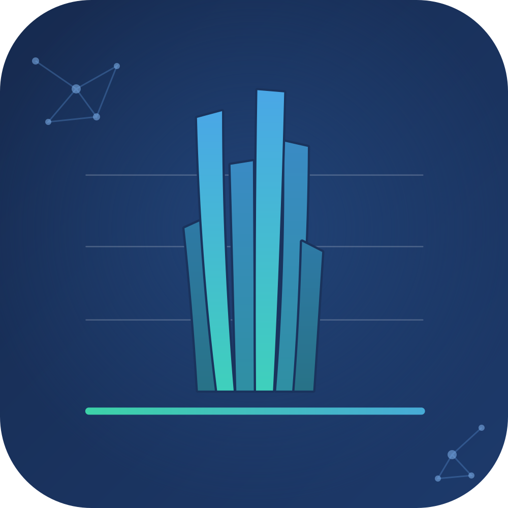

<p align="center">
  <a href="https://github.com/dse-club-kfupm"></a>
</p>

<h1 align="center">World Cup Oracle</h1>

<p align="center">
  <b>Can a model call the match?</b><br>
  A term 262 learning project of the <a href="https://github.com/dse-club-kfupm">Data Engineering &amp; Science Club, KFUPM</a>
</p>

<p align="center">
  <a href="https://docs.python.org/3/tutorial/"></a>
  <a href="https://jupyter.org"></a>
  <a href="https://pandas.pydata.org"></a>
  <a href="https://scikit-learn.org"></a>
  <a href="https://matplotlib.org"></a>
  <a href="https://www.manim.community"></a>
</p>

<p align="center">
  <a href="https://github.com/dse-club-kfupm"></a>
  
  <a href="#grading"></a>
  <a href="data/README.md"></a>
  <a href="https://github.com/dse-club-kfupm/262-world-cup-oracle/actions/workflows/format-check.yml"></a>
</p>

<p align="center">
  <a href="#at-a-glance"><b>At a glance</b></a> ·
  <a href="#the-data"><b>Data</b></a> ·
  <a href="#learn-first"><b>Learn first</b></a> ·
  <a href="#get-started"><b>Get started</b></a> ·
  <a href="#how-the-work-flows"><b>Workflow</b></a> ·
  <a href="#what-you-submit"><b>Submit</b></a> ·
  <a href="#grading"><b>Grading</b></a> ·
  <a href="#rules"><b>Rules</b></a>
</p>

On 22 November 2022, Saudi Arabia beat Argentina 2-1 at the World Cup in Qatar, one of the great upsets of the tournament. Football results are uncertain, but they are not random: stronger teams win more often, playing at home helps, and recent form matters.

In this project you build a model that predicts the result of an international match (a win for the first-listed team, a draw, or a win for the second-listed team) from the history of past results.

> [!NOTE]
> This is a case study. You will not build a betting tool or a live service. You work with one table of past results and show how the data science workflow (understanding, cleaning, exploring, modelling and communicating) answers the question on that table. Your model is tested on the matches of the 2026 FIFA World Cup, which it has never seen.

## At a glance

|  |  |
| --- | --- |
| **Client** | An analyst preparing match reports for a national team's technical staff |
| **Question** | Given two teams, the date and the venue, which result is most likely? |
| **You predict** | `result`: `home_win`, `draw` or `away_win`, where “home” means the first-listed team |
| **Scored by** | Balanced accuracy on the 2026 World Cup matches ([details](#grading)) |
| **Training data** | 49,470 matches × 10 columns in `data/train.csv` |
| **Level** | DATA 211, Introduction to Data Science |
| **Graded out of** | 100: 50 for the prediction, 50 for charts, slides and an animation |

## The data

`data/train.csv` holds every men's full international match in the source from 30 November 1872 to 10 June 2026, the day before the 2026 World Cup began. The committee keeps the World Cup matches as the hidden test set. For a test match your model receives the date, the teams, the tournament and the venue; the result is what it must predict.

Teams appear under their current names; countries appear under the name they had at the time of the match.

| Column | Meaning | Unit |
| --- | --- | --- |
| `date` | Match date | YYYY-MM-DD |
| `home_team` | First-listed team; the host when `neutral` is FALSE | text |
| `away_team` | Second-listed team | text |
| `home_score` | Goals by the first-listed team, including extra time | goals |
| `away_score` | Goals by the second-listed team, including extra time | goals |
| `tournament` | Competition, for example FIFA World Cup or Friendly | text |
| `city` | City where the match was played | text |
| `country` | Country where the match was played | text |
| `neutral` | TRUE if neither team played at home | TRUE or FALSE |
| `result` | **Target:** `home_win`, `draw` or `away_win` | label |

Test rows contain every column except `home_score`, `away_score` and `result`.

### Watch out for

- **Strength comes from history.** A test row has no scores, only who played, where and when. Your features have to come from past results in `data/train.csv`, such as recent form or a rating like Elo. `predict.py` may read `data/train.csv` to build them.
- **Draws are hard.** In the training data, 49% of matches are wins for the first-listed team, 28% wins for the second and 23% draws. Balanced accuracy counts a draw as much as a win, so a model that never predicts a draw loses a third of the score.
- **Old football is different football.** A match from 1930 says little about a team today. Decide how far back to look, and check that choice on your validation split.
- **Penalties count as draws.** Scores include extra time but not penalty shoot-outs, so a knockout match decided on penalties is a draw.
- **The answers are public.** The 2026 World Cup results are known. Using them in any way breaks the rules, and every member must be able to explain each step of the model.

**Source.** International football results from 1872 to 2026, compiled by Mart Jürisoo. Licence: CC0 1.0 (public domain). <https://github.com/martj42/international_results>

## Learn first

Everything here is at the level of DATA 211, Introduction to Data Science. If you have passed it, skim the list and open only what you are unsure about. You do not need everything on day one: learn each row before the milestone that needs it. Most Kaggle Learn courses take a few hours and run in the browser.

| When | Skill | Why you need it | Start with | Go further |
| --- | --- | --- | --- | --- |
| Before you start | Git and GitHub | Every change reaches `main` through a reviewed pull request | [Introduction to GitHub](https://github.com/skills/introduction-to-github) · GitHub Skills | [Pro Git](https://git-scm.com/book/en/v2), chapters 1 to 3 |
| Before you start | Python | The notebooks and `predict.py` are Python | [Python](https://www.kaggle.com/learn/python) · Kaggle Learn | [The Python Tutorial](https://docs.python.org/3/tutorial/) · python.org |
| Before you start | Environments | Install the project's packages without breaking anything else | [Virtual environments and packages](https://docs.python.org/3/tutorial/venv.html) · python.org |  |
| Milestone 1 | pandas | Load, inspect and reshape the table | [Pandas](https://www.kaggle.com/learn/pandas) · Kaggle Learn | [10 minutes to pandas](https://pandas.pydata.org/docs/user_guide/10min.html) · pandas docs |
| Milestone 1 | Data cleaning | Decide what to do with missing and unusual values | [Data Cleaning](https://www.kaggle.com/learn/data-cleaning) · Kaggle Learn | [Working with missing data](https://pandas.pydata.org/docs/user_guide/missing_data.html) · pandas docs |
| Milestone 1 | The field | Know what each column means in the real world | [The dataset page](https://www.kaggle.com/datasets/martj42/international-football-results-from-1872-to-2017) · Kaggle, explains every file and column |  |
| Milestone 2 | Charts | Show how the features relate to the target | [Data Visualization](https://www.kaggle.com/learn/data-visualization) · Kaggle Learn | [Ten Simple Rules for Better Figures](https://doi.org/10.1371/journal.pcbi.1003833) · PLOS |
| Milestone 3 | Prediction | Train a first model and compare it with the baseline | [Intro to Machine Learning](https://www.kaggle.com/learn/intro-to-machine-learning) · Kaggle Learn | [Getting started](https://scikit-learn.org/stable/getting_started.html) · scikit-learn |
| Milestone 3 | Better models | Pipelines, categorical columns, missing values and leakage | [Intermediate Machine Learning](https://www.kaggle.com/learn/intermediate-machine-learning) · Kaggle Learn | [Feature Engineering](https://www.kaggle.com/learn/feature-engineering) · Kaggle Learn |
| Milestone 3 | Your score | Balanced accuracy, and a validation split by date | [Balanced accuracy](https://scikit-learn.org/stable/modules/model_evaluation.html#balanced-accuracy-score) · scikit-learn | [Time series split](https://scikit-learn.org/stable/modules/cross_validation.html#time-series-split) · scikit-learn |
| Milestone 3 | Team ratings | Turn past results into one strength number per team | [Elo rating system](https://en.wikipedia.org/wiki/Elo_rating_system) · Wikipedia | [World Football Elo Ratings](https://en.wikipedia.org/wiki/World_Football_Elo_Ratings) · Wikipedia |
| Milestone 4 | Animation | Tell the story in motion, up to 2 minutes | [Quickstart](https://docs.manim.community/en/stable/tutorials/quickstart.html) · Manim | [Animations using Matplotlib](https://matplotlib.org/stable/users/explain/animations/animations.html) · Matplotlib |
| Milestone 4 | Slides | Take the client from the question to the answer in 5 to 7 slides | [Ten Simple Rules for Making Good Oral Presentations](https://doi.org/10.1371/journal.pcbi.0030077) · PLOS |  |

## Get started

You need Python 3.10 or newer and Git.

```bash
git clone https://github.com/dse-club-kfupm/262-world-cup-oracle.git
cd 262-world-cup-oracle
python -m venv .venv
source .venv/bin/activate        # Windows: .venv\Scripts\activate
pip install -r requirements.txt
jupyter lab
```

Then open `notebooks/01_data_understanding.ipynb` and work through its questions.

- **No setup on your laptop?** Google Colab works: upload `data/train.csv`, and commit your notebooks back to this repository.
- **Making the animation?** Install Manim on its own with `pip install manim`, after the system packages listed in the [Manim installation guide](https://docs.manim.community/en/stable/installation.html).

## How the work flows

The work is split into four milestones. Each one has its own issues in the [Issues tab](https://github.com/dse-club-kfupm/262-world-cup-oracle/issues), and it is done when all of them are closed.

| Milestone | Done when |
| --- | --- |
| 1. Data understanding | Notebook 01 and the cleaning functions in `src/features.py` are merged |
| 2. Exploration | Notebook 02, with charts and written findings, is merged |
| 3. Prediction submission | Notebook 03 and `src/predict.py` are merged and pass the format check |
| 4. Visual communication | The slides and the animation or video are merged |

For every change:

1. Pick an open issue and assign yourself to it.
2. Create a branch for it: `git switch -c short-description`.
3. Commit in small steps with clear messages, then push the branch.
4. Open a pull request into `main` and write `Closes #<issue number>` in its description.
5. A teammate reviews it. When it is approved and the format check has passed, merge it.

**Validation tip for milestone 3.** The test matches come after every training match, so split by date: for example, validate on the matches of 2024 and 2025 and train on everything before.

## What you submit

**Part A · Prediction (50 points)**

- [ ] `src/predict.py` with a function `predict(df)`. It receives a table with the test columns and returns one of `home_win`, `draw` or `away_win` per row, in the same order as the rows of `df`.
- [ ] Notebooks 01 to 03, run from top to bottom, showing how you reached the model.
- [ ] A passing format check. Run `python tests/check_submission.py` from the repository root before your final pull request; the same check also runs automatically on every pull request.

**Part B · Visual communication (50 points)**

- [ ] Clear, labelled charts in the notebooks.
- [ ] 5 to 7 slides that take the client from the question to the answer, saved as PDF in `visuals/slides/`.
- [ ] An animation or a short video of up to 2 minutes made with Python (Manim or matplotlib), with its source code and the rendered file in `visuals/animation/`. A good subject: how the strength of a few national teams rises and falls over the decades, or how your model's predicted chances change from match to match during a tournament.

## Grading

Your `predict.py` is run once on the hidden test set after the submission deadline. You get the points of the highest level you reach; they are not added up.

| Level | You need | Points |
| --- | --- | --- |
| Runs | Returns a valid prediction for every test row | 10 |
| Bronze | Balanced accuracy above the baseline's 33.3% (the baseline always predicts a win for the first-listed team) | 30 |
| Silver | Balanced accuracy of at least 45.3% | 40 |
| Gold | Balanced accuracy of at least 57.4%, the committee's reference model | 50 |

Balanced accuracy is the average, over the three results, of the share of matches with that result that your model predicts correctly. A model that always gives the same answer scores 33.3%.

| Part B | Missing | Basic | Good | Excellent |
| --- | --- | --- | --- | --- |
| Charts in the notebooks | 0 | 5 | 10 | 15 |
| Slides, 5 to 7, as PDF | 0 | 5 | 10 | 15 |
| Animation or video, made with Python, up to 2 minutes | 0 | 7 | 14 | 20 |

> [!IMPORTANT]
> Any team member may be asked to explain any part of the work. If no one can, the Part A points do not count.

## Rules

- Train only on `data/train.csv`.
- History for a test match may come only from `data/train.csv`. Results of matches played on or after 11 June 2026 may not be used.
- Every change reaches `main` through a pull request reviewed by a teammate.
- `predict.py` may use only pandas, NumPy and scikit-learn, so that it runs in the grading environment. Notebooks and visuals may also use matplotlib, seaborn, plotly and Manim.
- AI tools are allowed if you declare them in the Credits section, and every member must be able to explain the work.

## Repository structure

```text
262-world-cup-oracle/
├── README.md
├── requirements.txt
├── data/
│   ├── train.csv
│   └── README.md               source and licence
├── notebooks/
│   ├── 01_data_understanding.ipynb
│   ├── 02_cleaning_and_exploration.ipynb
│   └── 03_modelling.ipynb
├── src/
│   ├── features.py             cleaning and feature functions
│   └── predict.py              submission entry point
├── models/                     saved model, if predict.py loads one
├── tests/
│   └── check_submission.py     run before submitting
└── visuals/
    ├── slides/                 presentation as PDF
    └── animation/              animation source code and rendered video
```

## Credits

- **Project leads:** Name (@github), Name (@github)
- **Contributors:** Name (@github)
- **Organized by:** Applied Projects Committee, Data Engineering & Science Club, KFUPM
- **Data:** International football results from 1872 to 2026, compiled by Mart Jürisoo. Licence: CC0 1.0 (public domain).
- **AI tools used:** none, or name the tool and what it was used for

---

<p align="center">
  <sub>Applied Projects Committee · <a href="https://github.com/dse-club-kfupm">Data Engineering &amp; Science Club, KFUPM</a> · نادي هندسة وعلوم البيانات</sub>
</p>
